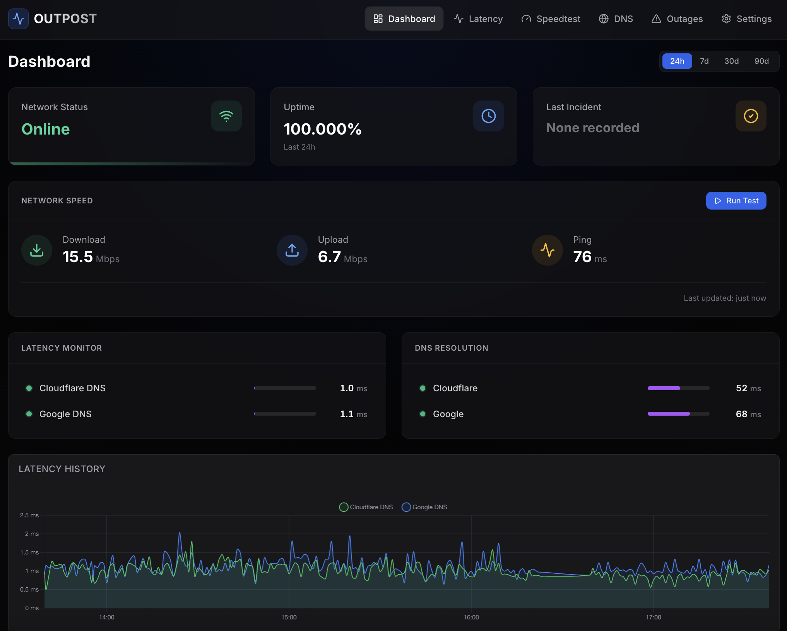

# Outpost - Home Network Health Monitor

A Docker-based network health monitoring solution that tracks internet connectivity, speed, latency, and DNS health through an intuitive web dashboard.

## Features

- **Latency Monitoring**: ICMP ping to configurable targets (Google DNS, Cloudflare DNS, custom hosts)
- **Speedtest Monitoring**: Periodic download/upload speed measurements
- **DNS Health**: Query resolution time and failure detection
- **Outage Tracking**: Automatic detection with precise start/end times
- **Web Dashboard**: Clean, responsive interface with real-time charts
- **Data Retention**: Configurable retention period (default: 90 days)
- **SQLite Storage**: Single-file database, no external dependencies

## Screenshot



## Quick Start

### Using Docker Compose (Recommended)

```bash
# Clone or navigate to the repository
cd outpost

# Start the application
docker compose up -d

# View logs
docker compose logs -f outpost

# Stop the application
docker compose down
```

The application will be available at `http://localhost:3000`

### Using Docker Build

```bash
# Build the image
docker build -t outpost .

# Run the container
docker run -d \
  --name outpost \
  --network host \
  -v outpost_data:/data \
  -e OUTPOST_PORT=3000 \
  -e OUTPOST_RETENTION_DAYS=90 \
  outpost
```

### Bridge Network Mode

If you prefer not to use host network mode, use the bridge configuration:

```bash
docker compose -f docker-compose.bridge.yml up -d
```

Note: Bridge network mode may slightly affect latency measurements.

## Configuration

### Environment Variables

- `OUTPOST_PORT`: Server port (default: 3000)
- `OUTPOST_DATA_DIR`: Data directory path (default: /data)
- `OUTPOST_PING_INTERVAL`: Ping interval in seconds (default: 60)
- `OUTPOST_SPEEDTEST_INTERVAL`: Speedtest interval in hours (default: 1)
- `OUTPOST_DNS_INTERVAL`: DNS check interval in seconds (default: 300)
- `OUTPOST_RETENTION_DAYS`: Data retention period (default: 90)
- `OUTPOST_DEGRADATION_WINDOW_MINUTES`: WAN degradation window in minutes (default: 30)
- `OUTPOST_DEGRADATION_LOSS_PERCENT`: Window packet loss above which a target counts as degraded (default: 5; decimals allowed)
- `OUTPOST_DEGRADATION_MIN_TARGETS`: How many covered targets must each exceed the loss threshold (default: 2)

### Configuration File

The application creates a configuration file at `/data/config.json` which can be modified through the web interface at `/settings` or manually.

Not every setting is exposed in the web interface. `monitors.ping.packetCount` (ICMP packets per check, 1–10, default 3) and `monitors.ping.timeout` are file-only and require a restart to take effect.

Default configuration:
```json
{
  "monitors": {
    "ping": {
      "enabled": true,
      "intervalSeconds": 60,
      "targets": [
        { "host": "8.8.8.8", "name": "Google DNS" },
        { "host": "1.1.1.1", "name": "Cloudflare DNS" }
      ],
      "timeout": 5000,
      "packetCount": 3
    },
    "speedtest": {
      "enabled": true,
      "intervalHours": 1
    },
    "dns": {
      "enabled": true,
      "intervalSeconds": 300,
      "servers": [
        { "address": "8.8.8.8", "name": "Google" },
        { "address": "1.1.1.1", "name": "Cloudflare" }
      ],
      "testDomains": ["google.com", "cloudflare.com"]
    }
  },
  "degradation": {
    "windowMinutes": 30,
    "lossThresholdPercent": 5,
    "recoveryLossThresholdPercent": null,
    "minTargets": 2,
    "minCoverage": 0.9,
    "staleAfterIntervals": 3
  },
  "retention": {
    "days": 90
  }
}
```

### WAN Degradation

Outpost classifies the connection as `healthy`, `degraded`, `outage` or
`insufficient` from the packet counts of the ping checks it already runs. It
sends no extra traffic. Each check stores packets sent and received, so a
check that got some replies still counts its lost packets.

- **Window loss** per target = (sent − received) / sent, summed over the last
  `windowMinutes`.
- **degraded**: at least `minTargets` covered targets each lost **more than**
  `lossThresholdPercent` (exactly 5.0% is not degraded). Loss on one target
  alone is not WAN degradation.
- **insufficient**: fewer than `minTargets` targets are covered. A target is
  covered when its newest check is no older than `staleAfterIntervals` ping
  intervals and it has at least `minCoverage` of the expected checks in the
  window (30 at a 60 s interval, so 27 at 0.9). Missing or stale data is never
  reported as healthy. Checks stored before packet counts existed (older
  versions) are not counted.
- **outage**: an outage is active. The existing outage detection is unchanged
  and always takes precedence.
- **Startup**: the state is `insufficient` until coverage is reached (about 27
  minutes at the defaults) and is decided from then on. There is no extra
  hold time on top of the window.
- **Recovery**: the state leaves `degraded` when fewer than `minTargets`
  covered targets are over the threshold. Set `recoveryLossThresholdPercent`
  below `lossThresholdPercent` to require loss to fall further before
  recovering. `null` means no extra hysteresis. The rolling window already
  smooths single bad checks. After an outage ends, its lost packets stay in the
  window, so the state can read `degraded` until they age out.

The defaults mirror a homelab Prometheus rule: over 5% loss over 30 minutes on
two independent public targets. This status is not alerted on. The existing
`alerts.packetLossThresholdPercent` notification is a separate, per-check rule.

## Web Interface

### Dashboard (`/`)
- Current network status
- Latest speedtest results
- Real-time latency for all targets
- DNS health indicators
- Latency history chart

### Latency (`/latency`)
- Detailed latency charts over time
- Per-target statistics (success rate, avg/min/max latency, packet loss)

### Speedtest (`/speedtest`)
- Speed history charts (download/upload)
- Manual speedtest trigger
- Individual test results with timestamps

### DNS (`/dns`)
- Per-server health cards
- Query response times
- Recent query history

### Outages (`/outages`)
- Active outage alerts
- Historical outage timeline
- Uptime percentage
- Total downtime statistics

### Settings (`/settings`)
- Configure monitor intervals
- Add/remove ping targets
- Add/remove DNS servers
- Set data retention period

## API Endpoints

### Metrics
- `GET /api/ping` - Get ping results
- `GET /api/ping/latest` - Latest ping per target
- `GET /api/speedtest` - Get speedtest results
- `GET /api/speedtest/latest` - Latest speedtest
- `GET /api/dns` - Get DNS query results
- `GET /api/dns/latest` - Latest DNS per server
- `GET /api/outages` - Get outage records
- `GET /api/stats?period=24h` - Aggregated statistics

### Actions
- `POST /api/speedtest/run` - Trigger manual speedtest
- `GET /api/speedtest/run/:id` - Check speedtest job status
- `GET /api/status` - Current outage status, plus `degradation` (state, reason, window loss and per-target coverage)

### Configuration
- `GET /api/config` - Get current configuration
- `PATCH /api/config` - Update configuration
- `POST /api/config/reset` - Reset to defaults

### Health
- `GET /api/health` - Health check endpoint

### Prometheus
- `GET /api/metrics` - Prometheus text format. WAN degradation series:
  `outpost_wan_degradation_state{state}` (1 for the current state, 0 for the
  others), `outpost_wan_window_loss_ratio`, `outpost_wan_window_covered_targets`,
  `outpost_wan_window_seconds`, `outpost_wan_loss_threshold_ratio`, and per
  configured ping target `outpost_ping_window_loss_ratio{target,name}` and
  `outpost_ping_window_coverage_ratio{target,name}`. Loss ratios are omitted
  when there is no data.

## Data Storage

All data is stored in a single SQLite database at `/data/outpost.db`.

### Tables
- `ping_results` - Latency measurements and ICMP packets sent/received per check
- `speedtest_results` - Speed test results
- `dns_results` - DNS query results
- `outages` - Outage records

### Backup

To backup your data:
```bash
docker cp outpost:/data/outpost.db ./backup.db
```

To restore:
```bash
docker cp ./backup.db outpost:/data/outpost.db
docker compose restart
```

## Development

### Prerequisites
- Node.js 22+
- npm

### Local Development

```bash
# Install dependencies
npm install

# Run backend and frontend in development mode
npm run dev

# Backend will run on http://localhost:3000
# Frontend will run on http://localhost:3001
```

### Build

```bash
# Build frontend for production
npm run build

# Start production server
npm start
```

## Architecture

### Backend
- **Runtime**: Node.js 22
- **Framework**: Fastify
- **Database**: better-sqlite3
- **Scheduler**: node-cron
- **Monitoring**: ping, Ookla speedtest CLI (with speedtest-cli fallback), native DNS

### Frontend
- **Framework**: Next.js 14+ with App Router
- **UI**: React 19
- **Styling**: Tailwind CSS
- **Charts**: Chart.js with react-chartjs-2

## Troubleshooting

### Container keeps restarting
```bash
docker compose logs outpost
```
Check for errors in the logs. Common issues:
- Port already in use
- Insufficient permissions for ICMP ping
- Data directory permissions

### Speedtest not working
Speedtest requires:
- Working internet connection
- NET_RAW capability (automatic with host network mode)
- The Ookla `speedtest` CLI or the Python `speedtest-cli` package installed

The Ookla CLI (bundled in the Docker image) streams live progress, so manual
runs from the dashboard show the current speed while the test is running. If
only the Python `speedtest-cli` is available, tests still work but results
only appear once the test completes.

Note: scheduled speedtests run at a random minute offset past the hour, not at
:00 exactly. Speedtest.net rate-limits the server-list endpoint at the top of
the hour (when every cron-scheduled client in the world fires at once), which
makes tests scheduled at :00 fail with "Unable to connect to servers to test
latency". Failed runs are retried up to 3 times with backoff, and the failure
reason is stored with each result.

### No data showing up
Wait a few minutes for the monitors to run their first checks. Default intervals:
- Ping: Every 60 seconds
- DNS: Every 5 minutes
- Speedtest: Every 1 hour

## License

MIT License

## Version

1.0.0
